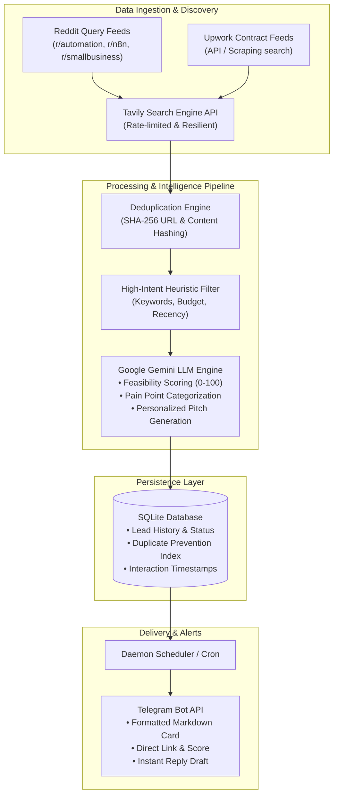

# 🔭 Vedetta AI — Autonomous Market & Job Intelligence Engine

[](https://www.typescriptlang.org/)
[](https://nodejs.org/)
[](https://ai.google.dev/)
[](https://www.sqlite.org/)
[](https://core.telegram.org/bots)
[](https://opensource.org/licenses/MIT)

> **Autonomous high-intent signal detection, AI scoring, and real-time deal alerting engine for B2B workflow automation opportunities.**

---

## 🇮🇹 Sintesi del Progetto (Executive Summary)

**Vedetta AI** è un sistema daemon autonomo progettato per eliminare lo scouting manuale di lead e opportunità B2B.  
Il sistema interroga in modo continuo motori di ricerca e community professionali (Reddit, Upwork, board di lavoro internazionali), individua post e richieste in cui aziende ed individui esprimono "pain point" operativi risolvibili tramite automazioni (n8n, Zapier, Python, integrazioni CRM, AI workflows), analizza e assegna un punteggio di rilevanza tramite **Google Gemini**, memorizza i lead in un database SQLite transazionale e recapita in tempo reale notifiche push strutturate su **Telegram** complete di bozza di risposta commerciale personalizzata.

---

## 🏛️ System Architecture



---

## ⚡ Key Engineering Highlights

1. **Zero-Infra Operating Cost (\$0/mo):**
   - Engineered to operate seamlessly within free tiers: Tavily Search (~480 queries/mo), Google Gemini Flash API, local SQLite ACID storage, and Telegram Bot API.
2. **Deterministic Deduplication:**
   - Content hashing prevents redundant API calls and eliminates alert fatigue.
3. **Resilient Retry with Exponential Backoff:**
   - Built-in rate limiting and graceful error handling against third-party API throttling.
4. **Structured JSON Output Parsing:**
   - Strict schema enforcement on Gemini responses ensuring reliable extraction of scores, identified pain points, and commercial pitches.

---

## 🚀 Quickstart

### 1. Prerequisites
- **Node.js** >= 18.0.0
- **npm** >= 9.0.0
- API Keys: Tavily (free), Google Gemini (free), Telegram Bot (free via `@BotFather`)

### 2. Installation
```bash
git clone https://github.com/GabriMannino-pt/Vedetta-ai.git
cd Vedetta-ai
npm install
```

### 3. Environment Configuration
Create a `.env` file based on `.env.example`:
```bash
cp .env.example .env
```
Populate the required environment variables:
```ini
# Tavily Search API
TAVILY_API_KEY=tvly-your-api-key

# Google Gemini AI
GEMINI_API_KEY=AIza-your-gemini-key

# Telegram Bot Alerts
TELEGRAM_BOT_TOKEN=1234567890:ABCdefGHIjklMNOpqrsTUVwxyz
TELEGRAM_CHAT_ID=123456789
```

### 4. Build & Execution
```bash
# Build TypeScript
npm run build

# Run one-off scouting cycle
npm run scout

# Start daemon mode
npm start
```

---

## 📊 Sample Telegram Alert Output

```text
🔭 [VEDETTA LEAD ALERT] · Score: 94/100
━━━━━━━━━━━━━━━━━━━━━━━━━━
🎯 Opportunity: Pipedrive to QuickBooks automated invoice sync
👤 Source: Upwork / Contract
🔗 Link: https://upwork.com/jobs/~01example...

💡 Pain Point Analysis:
Client manually re-enters 50+ invoices weekly between CRM and accounting software, causing reconciliation errors.

📝 Generated Outreach Proposal:
"Hi there, I build custom webhook and n8n sync pipelines connecting Pipedrive with accounting APIs. I can deliver an idempotent two-way sync with error alerts in 48 hours. Let's connect..."
```

---

## 🛡️ Privacy & Compliance
Vedetta operates exclusively on public data feeds. No private client data, proprietary credentials, or personal identifiers are stored or exposed.

---

## 👨‍💻 Author
**Gabriele Mannino**  
- GitHub: [@GabriMannino-pt](https://github.com/GabriMannino-pt)  
- LinkedIn: [linkedin.com/in/gabriele-mannino-dev](https://linkedin.com/in/gabriele-mannino-dev)  
- Email: `gabri.mannino.lavoro@gmail.com`
